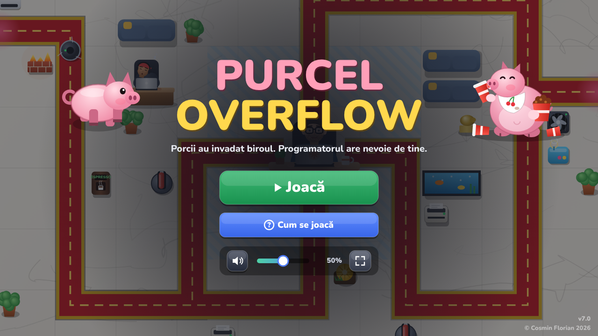
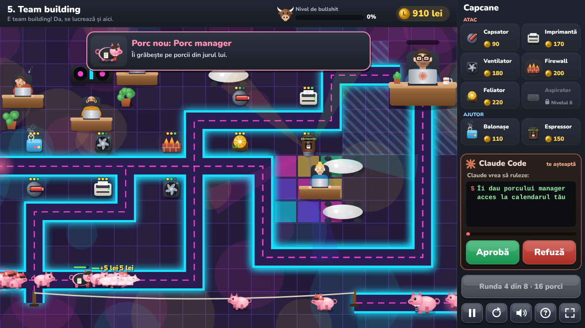
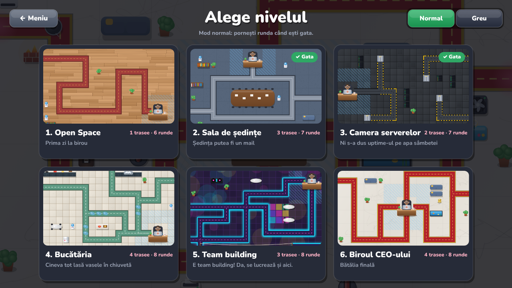
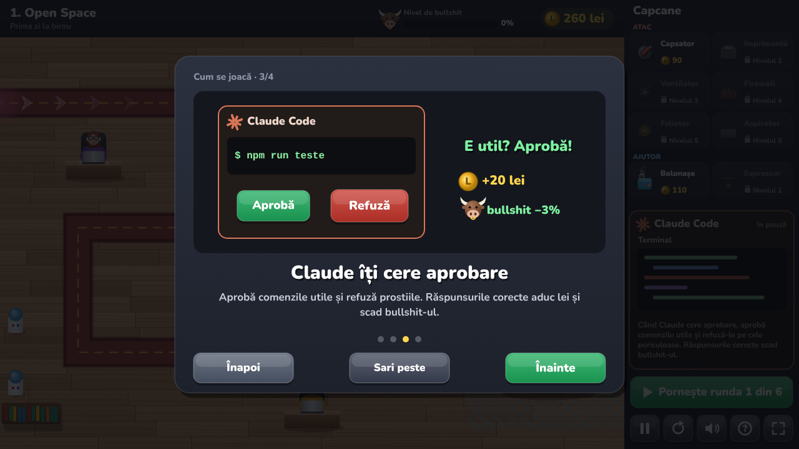

# 🐷 Purcel Overflow

**Un tower defense în browser în care porci roz invadează biroul unui programator.**
Pune capcane lângă hol, ține bullshit-ul jos și ai grijă ce aprobi când Claude vrea să ruleze comenzi.

### [▶ Joacă acum](https://cosminflrn.github.io/purcel-overflow/)

## Cum arată

| În joc | Alegerea nivelului |
|:---:|:---:|
|  |  |

## Ce găsești în joc

- 🏢 **6 nivele**, fiecare cu harta lui: Open Space, Sala de ședințe, Camera serverelor (cu lifturi), Bucătăria (cu podea udă), Team building (cu tiroliană și ring de dans) și Biroul CEO-ului
- 🪤 **8 capcane** cu câte 2 upgrade-uri:
  - de atac: Capsator, Imprimantă, Ventilator, Firewall, Feliator, Aspirator
  - de ajutor: Balonașe (îi prind în bule de săpun) și Espressor (dă boost capcanelor)
- 🔥 **Mod greu**: ai timp limitat între runde (primești bonus dacă pornești mai repede), porcii sunt mai rezistenți, iar jocul nu se oprește nici când schimbi tabul
- 🐖 **10 tipuri de porci**, de la Porcul de birou până la Porcul Rege, care face pământul să tremure
- 💥 **Fiecare capcană are animația ei** când doboară un porc. Uneori sare și câte o friptură
- 🤖 **Claude Code** cere aprobare pentru comenzi. Aprobi ce e util, refuzi prostiile, iar bara de bullshit îți spune cum te descurci
- 🎵 **Muzică și sunete** diferite pe fiecare nivel, generate în întregime din cod
- 📱 **Merge pe orice ecran**: desktop, tabletă sau telefon, cu buton de fullscreen și margini sigure pe telefoanele cu colțuri rotunjite

> **Pe iPhone:** Share → *Adaugă pe ecranul principal*, ca să-l ai pe tot ecranul, ca pe o aplicație.

## Cum e făcut

Tot jocul stă într-un singur fișier, [`index.html`](index.html), scris în **HTML + JavaScript simplu**, fără framework-uri, librării sau imagini externe.

- **Grafica** e desenată din cod pe un `<canvas>` HTML5, la fiecare cadru: porcii, programatorii, capcanele, hărțile și animațiile.
- **Muzica și efectele sonore** sunt sintetizate în timp real cu **Web Audio API**: oscilatoare, zgomot filtrat și un mic secvențiator pentru melodii.
- **Fontul** e [Nunito](https://fonts.google.com/specimen/Nunito), ales pentru diacriticele românești.
- **Progresul** se salvează în `localStorage`, în browser.
- **Hostingul** e gratuit, pe GitHub Pages. Fiecare push pe `main` actualizează jocul.
- **Balansul** a fost testat cu un bot care joacă singur nivelele în browser (Playwright), cu strategii „deștepte” și „naive”.

Jocul a fost construit de Cosmin împreună cu Claude, pornind de la un `.exe` simplu în C pentru Windows și ajungând la versiunea web de acum.

## Versiuni

Versiunea curentă apare în colțul din dreapta-jos al meniului. Fiecare versiune are și o ramură salvată (`versiune-v1.0` … `versiune-v7.0`).

| Versiune | Ce a adus |
|---|---|
| **v7.0** | Mod greu (timp limitat între runde, bonus pentru start rapid, jocul merge și cu alt tab deschis), muzica se oprește la pauză, porc gurmand în meniu, balonașe și pentru Porcul Rege, lanțul regelui refăcut |
| v6.0 | Animații de moarte diferite pentru fiecare capcană, friptura, balonașe mai echilibrate, margini sigure pe telefon, fullscreen din meniu, tutorial mai rapid |
| v5.0 | Panou de upgrade nou, animații pentru balonașe, hărți refăcute, rebalansare |
| v4.0 | Capcane noi (Ventilator, Feliator, Aspirator), nivelul 6, muzică de final |
| v3.0 | Tutorial, slider de volum, diacritice, prompturi Claude fără repetări |
| v2.0 | Muzică pe nivele, tipuri noi de porci, buton de fullscreen |
| v1.0 | Prima versiune web |

**Rollback:** GitHub → Branches → alegi versiunea, sau `git checkout versiune-v5.0 -- index.html`, apoi commit și push pe `main`.

© Cosmin Florian

